# PC Status

**Monitor de hardware para Windows con diseño propio**, inspirado en programas como NZXT CAM pero totalmente personalizable: medidores animados en tiempo real, inventario completo del PC, procesos que se pueden finalizar, alertas de temperatura con notificaciones, prueba de velocidad de internet, 6 temas con estilos distintos y 9 idiomas.

Hecho con **Tauri 2 (Rust)**, **React + Tailwind + Motion** y un pequeño proceso en **.NET con LibreHardwareMonitor** para leer los sensores.

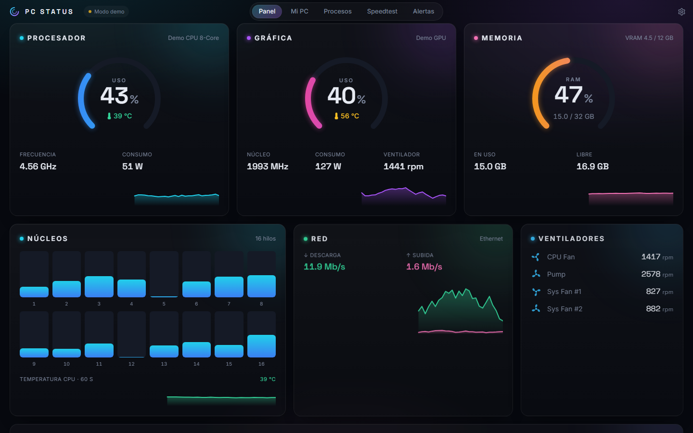

> Todas las capturas usan el **modo demo** (datos ficticios), que se activa al abrir la interfaz en un navegador normal.

---

## ⬇️ Descargar

### [**Descargar PC Status para Windows (instalador .exe)**](https://github.com/Reingardo/Pc-Status/releases/latest)

No necesitas instalar nada más: el instalador incluye todo (la app, el lector de sensores y su runtime de .NET).

**Requisitos:** Windows 10 u 11 de 64 bits, con WebView2 (ya viene en Windows 11 y en Windows 10 actualizado).

**Instalación:**

1. Descarga `PC-Status_x64-setup.exe` desde la [última versión](https://github.com/Reingardo/Pc-Status/releases/latest).
2. Ábrelo. Si Windows SmartScreen muestra *"Windows protegió su PC"*, pulsa **Más información → Ejecutar de todas formas** (sale porque el instalador no está firmado con un certificado de pago, es normal en proyectos personales).
3. Sigue el asistente. Puedes marcar **"Crear acceso directo en el escritorio"**.
4. Al abrir PC Status, Windows pedirá **permisos de administrador**: son necesarios para leer temperaturas de CPU, ventiladores y voltajes.

**Desinstalar:** Configuración de Windows → Aplicaciones → PC Status → Desinstalar.

**Code signing policy:** los instaladores se compilan automáticamente en GitHub Actions a partir de este código. Ver la [política de firma de código](CODE_SIGNING_POLICY.md). *Free code signing provided by [SignPath.io](https://about.signpath.io/), certificate by [SignPath Foundation](https://signpath.org/)* (en trámite: las versiones firmadas lo indicarán en su release).

---

## Funcionalidades de un vistazo

| | |
|---|---|
| [](#panel-monitoreo-en-tiempo-real) **📊 Panel**: CPU, GPU, RAM, núcleos, red, ventiladores y discos en tiempo real, con medidores animados y gráficas de 60 s. | [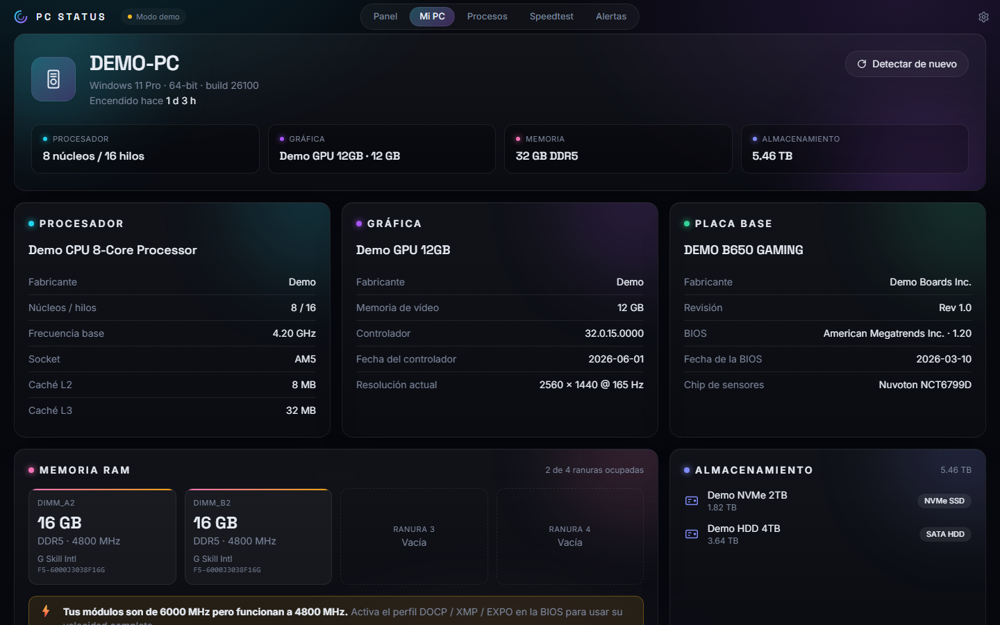](#mi-pc-inventario-de-hardware) **🖥️ Mi PC**: inventario completo del hardware: procesador, gráfica, placa y BIOS, RAM por ranura, discos, pantallas, red y audio. |
| [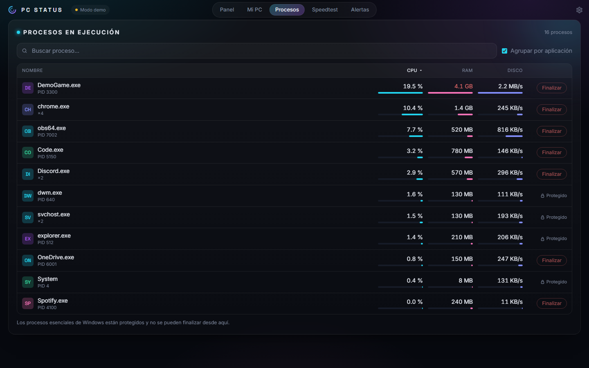](#procesos-qué-consume-recursos) **⚙️ Procesos**: qué aplicaciones consumen CPU, RAM y disco, con buscador y botón para finalizarlas. | [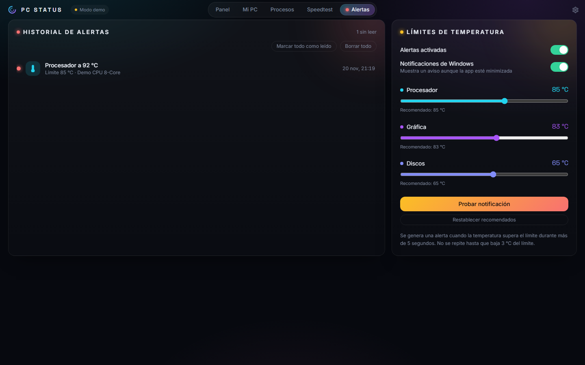](#alertas-de-temperatura) **🔔 Alertas**: notificación de Windows si la CPU, la GPU o un disco se calientan demasiado, con historial y punto rojo en las nuevas. |
| [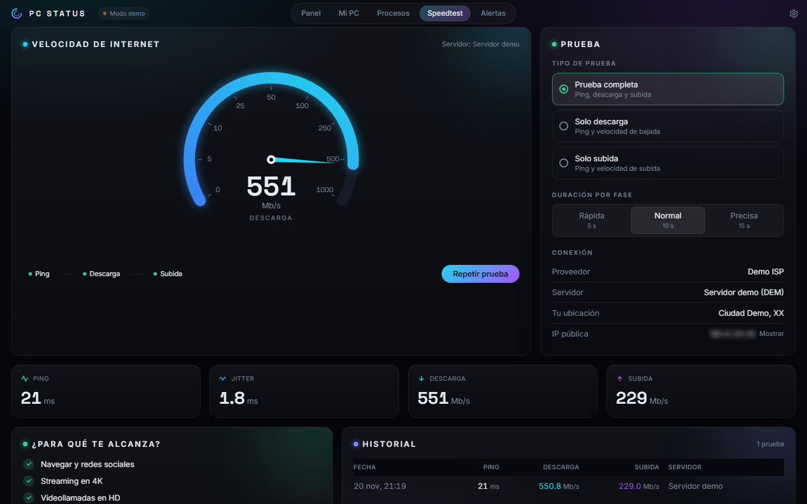](#speedtest-velocidad-de-internet) **🚀 Speedtest**: ping, jitter, descarga y subida con velocímetro, menú de tipo y duración, valoración e historial. | [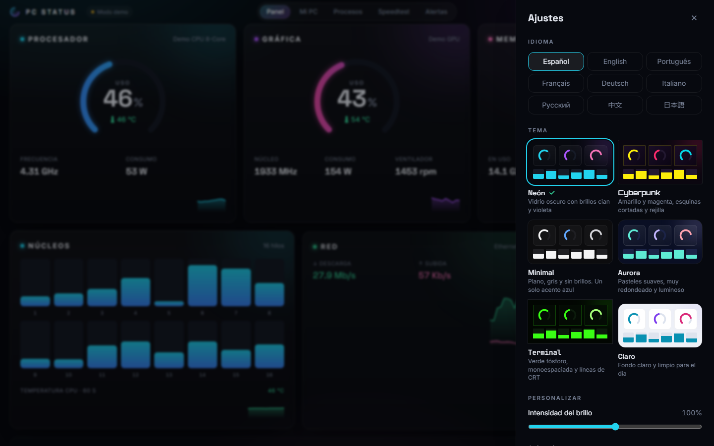](#ajustes-temas-e-idiomas) **🎨 Temas e idiomas**: 6 estilos distintos y 9 idiomas, con brillo ajustable y opción sin animaciones. |

---

## Índice

- [Descargar](#️-descargar)
- [Funciones](#funciones)
  - [Panel: monitoreo en tiempo real](#panel-monitoreo-en-tiempo-real)
  - [Mi PC: inventario de hardware](#mi-pc-inventario-de-hardware)
  - [Procesos: qué consume recursos](#procesos-qué-consume-recursos)
  - [Alertas de temperatura](#alertas-de-temperatura)
  - [Speedtest: velocidad de internet](#speedtest-velocidad-de-internet)
  - [Ajustes, temas e idiomas](#ajustes-temas-e-idiomas)
- [Cómo funciona por dentro](#cómo-funciona-por-dentro)
- [Instalación y uso](#instalación-y-uso)
- [Personalizar](#personalizar)
- [Estructura del proyecto](#estructura-del-proyecto)
- [Preguntas frecuentes](#preguntas-frecuentes)

---

## Funciones

### Panel: monitoreo en tiempo real

La vista principal se actualiza **cada segundo**:

| Tarjeta | Qué muestra |
|---|---|
| **Procesador** | Uso total con medidor animado, temperatura (cambia de color: verde → ámbar → rojo), frecuencia media, consumo en vatios y gráfica de los últimos 60 s |
| **Gráfica** | Uso, temperatura, frecuencia del núcleo, consumo y RPM del ventilador. Prioriza la GPU dedicada (NVIDIA / AMD) sobre la integrada |
| **Memoria** | RAM usada / total, libre y VRAM de la gráfica |
| **Núcleos** | Una barra por cada hilo del procesador + historial de temperatura |
| **Red** | Velocidad de descarga y subida con gráfica en vivo (ignora adaptadores virtuales) |
| **Ventiladores** | Cada ventilador de la placa con su RPM; el icono gira a la velocidad real |
| **Almacenamiento** | Cada disco con espacio usado, temperatura y actividad |

Si la app no tiene permisos de administrador lo indica con un aviso: sin ellos Windows no deja leer temperaturas de CPU, ventiladores ni discos.

### Mi PC: inventario de hardware


Detecta **todos los componentes** del equipo en menos de un segundo:

- **Sistema:** nombre del equipo, versión de Windows y tiempo encendido.
- **Procesador:** modelo, núcleos / hilos, frecuencia base, socket y cachés L2 / L3.
- **Gráfica:** modelo, VRAM real, versión y fecha del controlador, resolución y frecuencia de la pantalla.
- **Placa base y BIOS:** fabricante, modelo, revisión, versión y fecha de la BIOS y chip de sensores.
- **Memoria RAM:** una tarjeta por ranura (ocupada o vacía) con capacidad, tipo (DDR4 / DDR5), velocidad, marca y número de pieza.
- **Almacenamiento:** cada disco con su tamaño y tipo (NVMe / SATA, SSD / HDD).
- **Pantallas, red y audio** conectados.
- **Sensores disponibles:** qué componentes pueden dar temperaturas o ventiladores.

💡 **Detección de RAM lenta:** si el número de pieza indica que tus módulos son más rápidos de lo que están funcionando (por ejemplo un kit de 3600 MHz a 2666 MHz), la app te avisa de que actives el perfil **DOCP / XMP / EXPO** en la BIOS. Reconoce los números de pieza de G.Skill, Corsair y Kingston Fury.

El botón **"Detectar de nuevo"** vuelve a escanear el hardware sin reiniciar la app.

### Procesos: qué consume recursos


Lista de **todos los procesos en ejecución**, actualizada cada 2 segundos (solo mientras la pestaña está abierta, para no gastar recursos):

- **CPU** (% del procesador completo), **RAM** y **disco** (lectura + escritura por segundo), con barras para comparar de un vistazo. Los valores altos se marcan en rojo.
- **Agrupar por aplicación**: junta todos los procesos de una app (por ejemplo las pestañas de Chrome, `×4`) y suma su consumo.
- **Buscar** por nombre o PID y **ordenar** pulsando el título de cada columna.
- **Finalizar**: pide confirmación indicando el nombre y cuántos procesos se cerrarán. Si la app está agrupada, cierra todos sus procesos.
- **Protegidos**: los procesos esenciales de Windows (`svchost`, `csrss`, `explorer`, `dwm`…) y la propia PC Status no se pueden finalizar desde aquí.
- Con el ratón encima de la tabla **el orden se congela**, para que una fila no se mueva justo cuando vas a pulsar "Finalizar".

### Alertas de temperatura


Si un componente se calienta más de lo recomendado, PC Status:

1. Muestra una **notificación de Windows**, aunque la app esté minimizada.
2. Guarda la alerta en la pestaña **Alertas** con un **punto rojo** al inicio mientras no la hayas visto. La pestaña también muestra un punto rojo cuando hay alertas nuevas.

| Componente | Límite recomendado | Por qué |
|---|---|---|
| Procesador | 85 °C | la mayoría reduce su velocidad cerca de 90–95 °C |
| Gráfica | 83 °C | límite habitual antes de que baje su frecuencia |
| Discos | 65 °C | los SSD NVMe se protegen a partir de unos 70 °C |

- Los límites se pueden **ajustar** con deslizadores y restablecer a los recomendados.
- Una alerta salta cuando la temperatura **supera el límite más de 5 segundos** (no por picos de un instante) y **no se repite** hasta que baja 3 °C del límite.
- Botón **"Probar notificación"** para comprobar que las notificaciones funcionan.
- Las notificaciones o las alertas se pueden desactivar.

### Speedtest: velocidad de internet


Prueba de velocidad completa con **velocímetro animado** (escala 0–1000 Mb/s no lineal, como en los speedtest conocidos):

1. **Menú de prueba**
   - Tipo: *Prueba completa*, *Solo descarga* o *Solo subida*.
   - Duración por fase: *Rápida* (5 s), *Normal* (10 s) o *Precisa* (15 s).
2. Pulsa **INICIAR** en el centro del velocímetro.
3. La prueba pasa por las fases **Ping → Descarga → Subida** y la aguja muestra la velocidad en vivo.
4. Resultados: **ping, jitter, descarga y subida**, además de:
   - **Conexión:** proveedor, servidor usado y tu ubicación aproximada. La IP pública aparece difuminada hasta que pulses *Mostrar*.
   - **"¿Para qué te alcanza?":** navegar, streaming 4K, videollamadas HD, juegos en línea, transmitir en vivo, descargas grandes.
   - **Historial** de las últimas 20 pruebas.

**Cómo mide** (contra los servidores de Cloudflare, los mismos de [speed.cloudflare.com](https://speed.cloudflare.com)):

| Medida | Método |
|---|---|
| **Ping** | 15 peticiones vacías; a cada una se le resta el tiempo de procesado que informa el servidor (`Server-Timing`) y se toma la mediana |
| **Jitter** | Variación media entre pings consecutivos |
| **Descarga** | 6 conexiones en paralelo descargando bloques de 25 MB |
| **Subida** | 4 conexiones en paralelo enviando datos aleatorios (no comprimibles) |

Los primeros 1,5 s de cada fase no cuentan para el resultado (es el arranque de TCP). La medición la hace **Rust**, no el navegador, para que sea precisa. La prueba sigue aunque cambies de pestaña.

### Ajustes, temas e idiomas

El **engranaje ⚙️** (arriba a la derecha) abre el panel de ajustes:


Cada tema cambia **colores, esquinas, intensidad del brillo, fuentes, fondo y estilo de las tarjetas**. No es solo una paleta:

| | |
|---|---|
| **Cyberpunk**: amarillo y magenta, esquinas cortadas, franja lateral de color, fuente Orbitron, rejilla y líneas de CRT 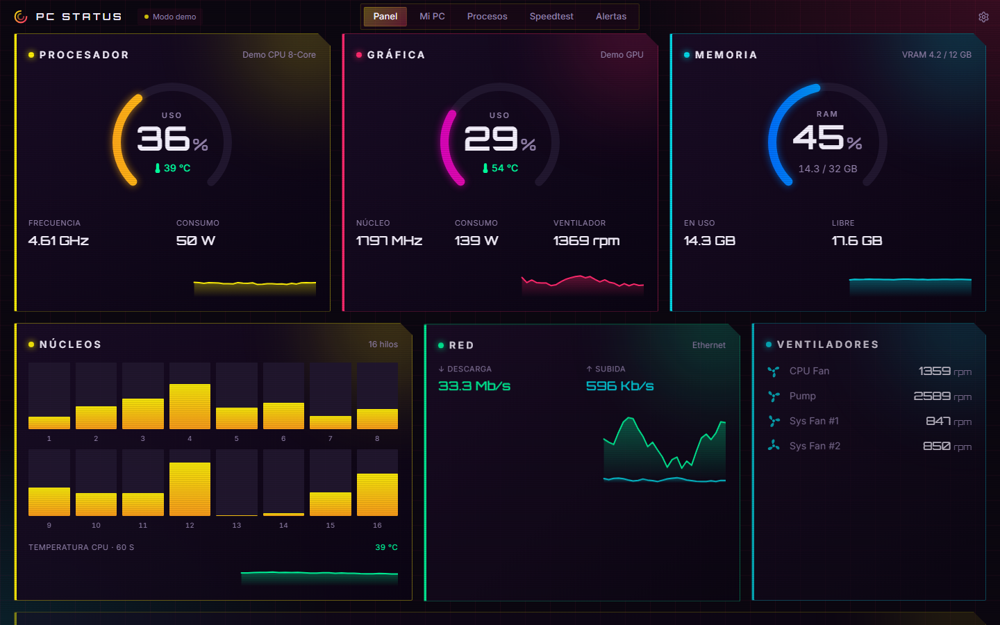 | **Terminal**: verde fósforo, todo monoespaciado, sin esquinas redondeadas y con efecto de monitor CRT 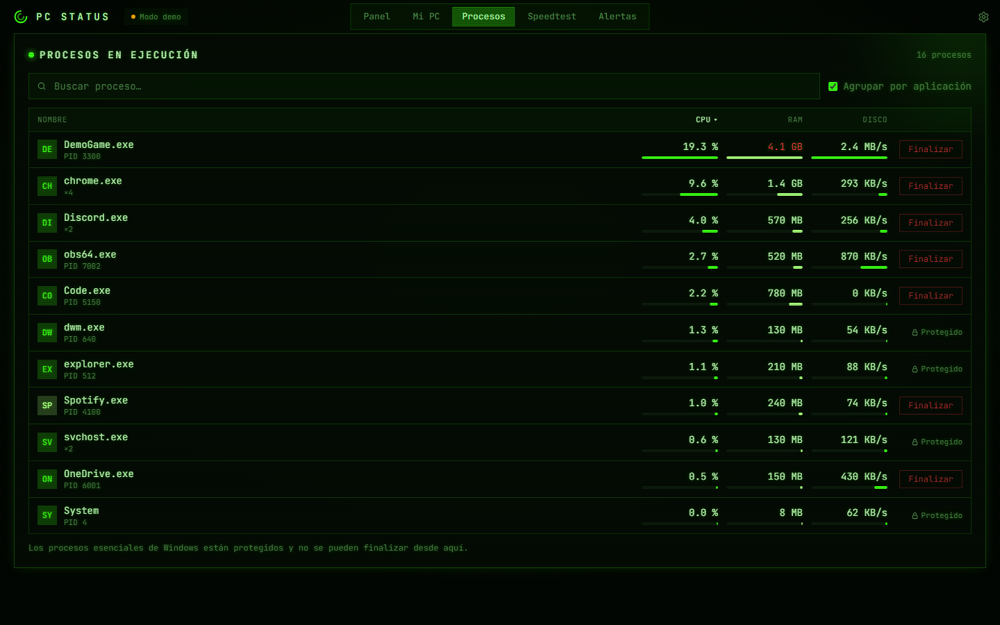 |
| **Aurora**: pasteles suaves, muy redondeado, vidrio difuminado y fondo de aurora boreal 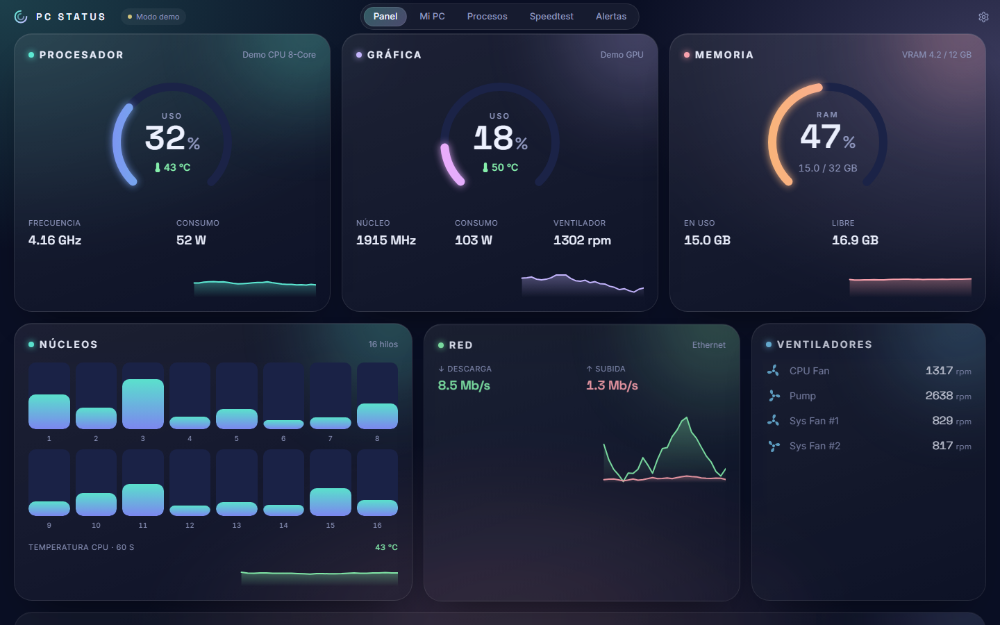 | **Claro**: fondo claro con tarjetas blancas, para el día 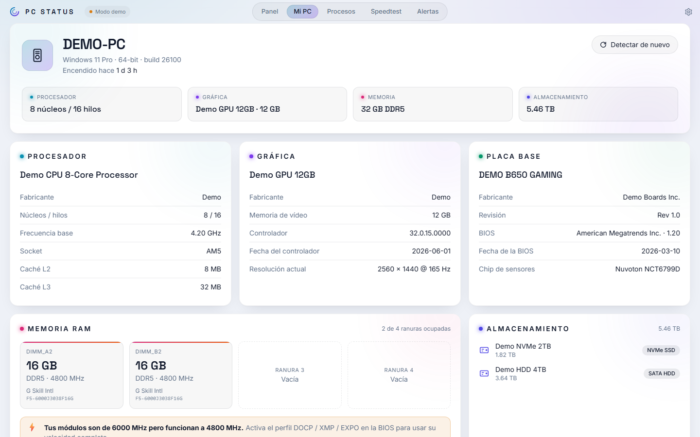 |
| **Minimal**: plano y gris, sin brillos, con un solo acento azul 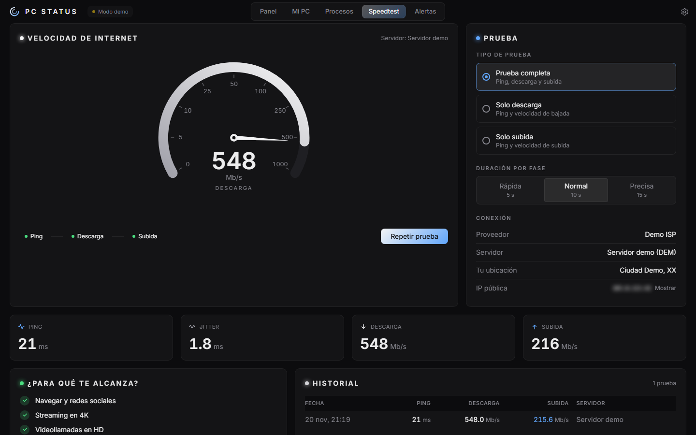 | **Neón** (por defecto): vidrio oscuro con brillos cian y violeta  |

**Idiomas:** Español, English, Português, Français, Deutsch, Italiano, Русский, 中文 y 日本語. La primera vez se usa el idioma de Windows si está disponible.

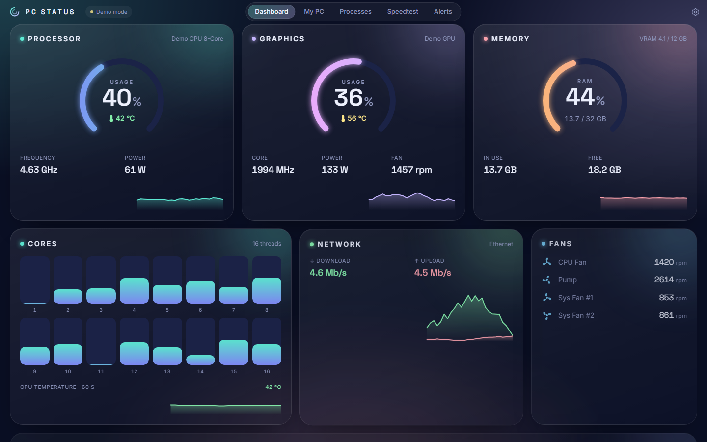

Además:
- **Intensidad del brillo**: 0–200 % sobre el brillo propio del tema.
- **Animaciones**: se pueden desactivar del todo.
- La elección se guarda y se aplica antes de pintar la ventana (sin parpadeo).

---

## Cómo funciona por dentro

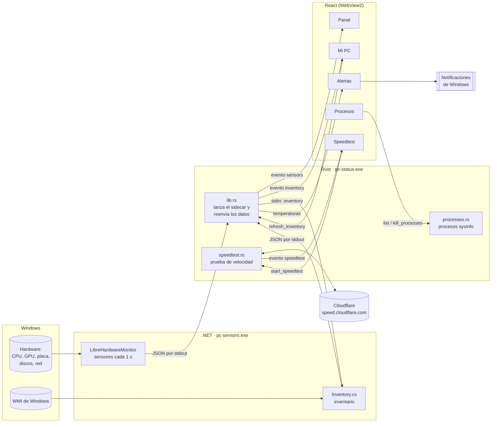

**¿Por qué un proceso en .NET?** En Windows, leer la temperatura real de la CPU, los ventiladores y los voltajes de la placa necesita un driver en modo kernel. La librería más completa para eso es [LibreHardwareMonitor](https://github.com/LibreHardwareMonitor/LibreHardwareMonitor) (C#) y no existe un equivalente en Rust. Por eso la app lanza un pequeño ejecutable .NET (*sidecar*) que:

1. Lee todos los sensores **cada segundo** y escribe una línea JSON por `stdout`.
2. Al arrancar (y cuando se le pide por `stdin`) genera el **inventario** usando WMI.
3. Se cierra solo si la app principal muere (detecta el fin de `stdin`).

El backend en **Rust** lanza ese proceso sin ventana, guarda el último inventario y reenvía todo a la interfaz con eventos de Tauri. La prueba de velocidad se hace directamente en Rust con `reqwest`, y la lista de procesos con `sysinfo`. Las alertas se calculan en la interfaz con cada lectura de sensores y se notifican con `tauri-plugin-notification`.

La **interfaz** es React dentro de WebView2: los temas son variables CSS (`--color-*`, `--radius`, `--glow`, `--card-*`, `--app-bg`...) que se cambian en caliente.

---

## Instalación y uso

> ¿Solo quieres usar la app? Descarga el instalador en [Descargar](#️-descargar). Esta sección es para **compilarla tú mismo** o modificarla.

### Requisitos

| Herramienta | Instalar |
|---|---|
| Windows 10 / 11 (x64) | con WebView2 (viene en Windows 11) |
| Node.js 20+ | <https://nodejs.org> |
| Rust (MSVC) | `winget install Rustlang.Rustup` |
| Herramientas C++ de Visual Studio | `winget install Microsoft.VisualStudio.2022.BuildTools --override "--passive --wait --add Microsoft.VisualStudio.Workload.VCTools --includeRecommended"` |
| .NET SDK 10 | `winget install Microsoft.DotNet.SDK.10` |

### Comandos

```bash
npm install          # dependencias de la interfaz
npm run dev          # solo la interfaz en el navegador, con datos DEMO (ideal para diseñar)
npm run app          # app completa con sensores reales (compila el sidecar la primera vez)
npm run sensors      # recompila el sidecar .NET
npm run app:build    # instalador .exe en src-tauri/target/release/bundle/nsis
```

### Permisos de administrador

LibreHardwareMonitor necesita **administrador** para leer temperaturas de CPU, ventiladores y voltajes.

- La versión compilada (`npm run app:build`) **pide permisos automáticamente** (UAC).
- En desarrollo, abre la terminal **como administrador** antes de `npm run app`.
- Sin permisos sigue funcionando el uso de CPU / GPU / RAM, la temperatura de la GPU NVIDIA, la red, el inventario y el speedtest.

### Modo demo y parámetros de URL

Con `npm run dev` la interfaz funciona en cualquier navegador con datos simulados. Parámetros útiles:

| Parámetro | Efecto |
|---|---|
| `?view=mypc` / `processes` / `speedtest` / `alerts` | abre esa pestaña |
| `?theme=cyberpunk` | fuerza un tema sin guardarlo (`neon`, `cyberpunk`, `minimal`, `aurora`, `terminal`, `light`) |
| `?settings` | abre el panel de ajustes |
| `?autostart` | lanza un speedtest simulado |
| `?lang=en` | fuerza un idioma (`es`, `en`, `pt`, `fr`, `de`, `it`, `ru`, `zh`, `ja`) |
| `?hot` | simula una CPU caliente para ver las alertas |
| `?nopawnio` | simula que falta el driver PawnIO |

---

## Personalizar

- **Crear un tema:** copia uno en [`src/lib/themes.ts`](src/lib/themes.ts) y cambia sus variables. Para efectos especiales (esquinas cortadas, líneas de CRT…) añade reglas `[data-theme="tu-tema"]` en [`src/index.css`](src/index.css).
- **Distribución de tarjetas:** [`src/views/`](src/views/) (rejilla de 12 columnas).
- **Componentes:** [`src/components/`](src/components/) (`Gauge`, `SpeedGauge`, `Sparkline`, `Card`, `TitleBar`, `SettingsPanel`).
- **Añadir sensores:** edita [`sensors/Program.cs`](sensors/Program.cs) y el tipo [`src/lib/types.ts`](src/lib/types.ts).
- **Añadir datos al inventario:** [`sensors/Inventory.cs`](sensors/Inventory.cs) y [`src/lib/inventory.ts`](src/lib/inventory.ts).

---

## Estructura del proyecto

```
├── src/                      Interfaz (React + Tailwind + Motion)
│   ├── App.tsx               pestañas, ajustes y vista activa
│   ├── views/                Dashboard · MyPC · Processes · Speedtest · Alerts
│   ├── components/           medidores, gráficas, tarjetas, barra de título, ajustes
│   └── lib/                  sensores, inventario, procesos, alertas, speedtest, temas, idiomas (i18n), demo
├── src-tauri/                App de escritorio (Rust / Tauri 2)
│   ├── src/lib.rs            lanza el sidecar, eventos y comandos
│   ├── src/speedtest.rs      motor de la prueba de velocidad
│   ├── src/processes.rs      lista de procesos y finalizar (sysinfo)
│   └── tauri.conf.json       ventana sin bordes, sidecar, instalador
├── sensors/                  Sidecar .NET (LibreHardwareMonitor + WMI)
│   ├── Program.cs            lectura de sensores cada segundo
│   └── Inventory.cs          inventario de hardware
├── scripts/build-sensors.mjs compila el sidecar y lo copia para Tauri
└── docs/screenshots/         capturas del README
```

---

## Preguntas frecuentes

**¿Por qué no veo la temperatura de la CPU?**
Hacen falta dos cosas: ejecutar la app como **administrador** y tener el driver **[PawnIO](https://pawnio.eu/)**, que LibreHardwareMonitor usa desde la versión 0.9.5 para leer temperaturas, ventiladores y voltajes. Si falta, PC Status muestra un aviso con el botón **"Instalar PawnIO"** (incluye el instalador oficial de namazso, verificado por SHA-256); Windows te pedirá permiso y los sensores se reinician solos al terminar.

**¿Puedo usarlo junto a NZXT CAM / Armoury Crate / iCUE?**
Sí, pero si varios programas leen el chip de la placa a la vez, algún valor puede salir raro. Cierra los otros si ves lecturas extrañas.

**¿El speedtest envía mis datos a algún sitio?**
Solo se conecta a `speed.cloudflare.com` para hacer la prueba (igual que si la hicieras en su web). El historial se guarda solo en tu PC.

**¿Por qué mi resultado es distinto al de Ookla / fast.com?**
Cada servicio usa servidores distintos; la velocidad depende de la ruta hasta cada uno. PC Status mide contra el servidor de Cloudflare más cercano.

---

## Code signing policy

Ver [CODE_SIGNING_POLICY.md](CODE_SIGNING_POLICY.md): qué se firma, roles del equipo y privacidad.

## Licencia

[MIT](LICENSE) © Reingardo.

## Créditos

- [LibreHardwareMonitor](https://github.com/LibreHardwareMonitor/LibreHardwareMonitor) (MPL-2.0): lectura de sensores.
- [Tauri](https://tauri.app), [React](https://react.dev), [Tailwind CSS](https://tailwindcss.com), [Motion](https://motion.dev).
- Fuentes: Inter, Space Grotesk, Orbitron, JetBrains Mono (vía Fontsource).
- Prueba de velocidad con la infraestructura pública de [Cloudflare Speed Test](https://speed.cloudflare.com).
